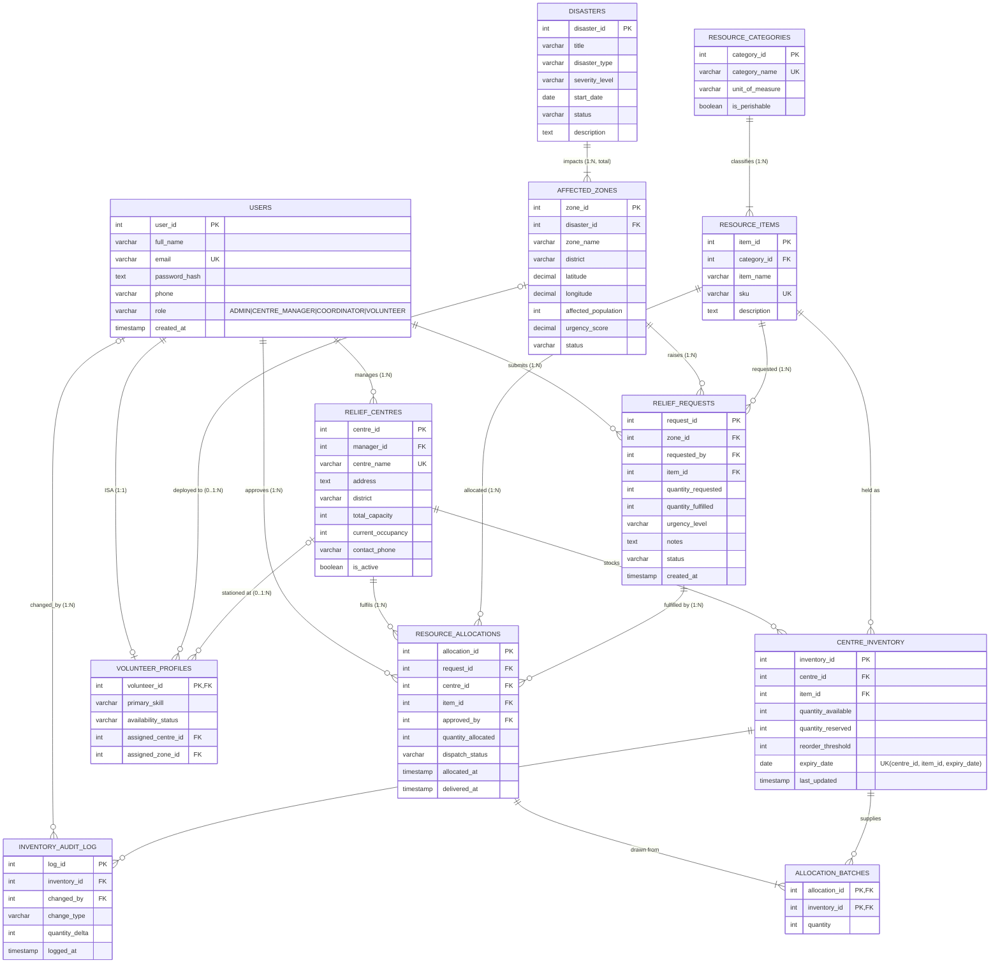
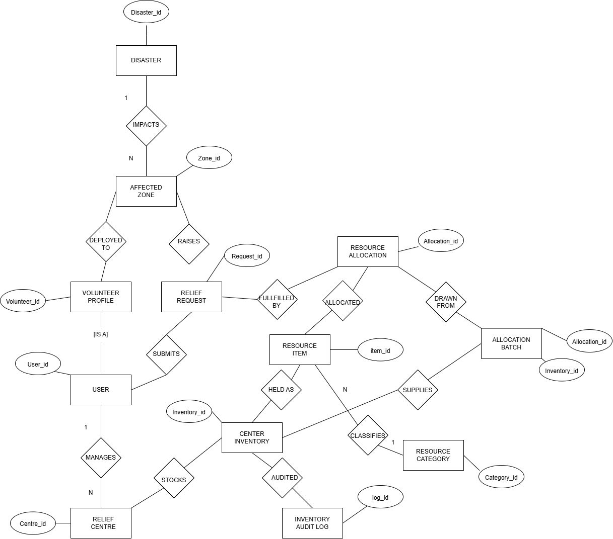

# Entity–Relationship Model

- `PK` = primary key, `FK` = foreign key, `UK` = unique.
- `CENTRE_INVENTORY` is the associative entity that resolves RELIEF_CENTRE M:N RESOURCE_ITEM.
- `VOLUNTEER_PROFILE` is a 1:1 ISA specialisation of `USER` (`volunteer_id` is both PK and FK).
- `ALLOCATION_BATCH` is an implementation table. It is a weak entity of `RESOURCE_ALLOCATION`
  and records which FEFO batches supplied each allocation.

## Chen-notation drawing checklist (§6.3 diagramming note)

